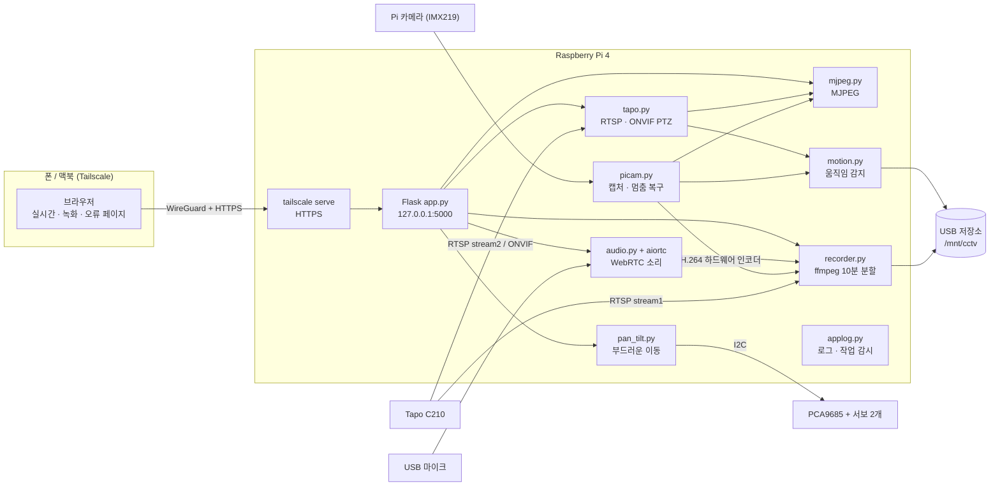

# Home CCTV

집에 있는 고양이를 밖에서도 보기 위해 Raspberry Pi 4로 만든 홈 CCTV.
카메라 2대(Pi 카메라 + Tapo C210)의 실시간 영상·소리, 팬틸트 제어, 24시간 녹화, 움직임 감지를 웹 한 곳에서 제공한다.
외부 접속은 포트포워딩 없이 Tailscale HTTPS로만 열고, Tapo 카메라도 제조사 클라우드 대신 집 안 네트워크(RTSP/ONVIF)로 직접 받는다.

<div>


</div>

## 아키텍처



## 기술 스택

| 분류 | 사용 기술 | 용도 |
|---|---|---|
| 하드웨어 | Raspberry Pi 4, Camera Module v2(IMX219), Arducam B0283 팬틸트(PCA9685 + GH-S37D), USB 마이크, Tapo C210, USB 저장소 | |
| 언어 | Python 3.11, JavaScript | |
| 웹 | Flask, Bootstrap 5, python-dotenv | 서버, 세션 로그인, 화면 |
| 카메라 | Picamera2(libcamera), OpenCV | Pi 카메라 캡처·H.264 인코딩, 이미지 처리 |
| 실시간 영상 | MJPEG (`multipart/x-mixed-replace`) | `` 한 줄로 재생 |
| 실시간 소리 | WebRTC (aiortc), sounddevice(PortAudio), PyAV | 지연 0.1~0.5초 |
| Tapo 연동 | RTSP, ONVIF (onvif-zeep) | 영상·소리 수신, PTZ |
| 녹화 | ffmpeg (segment, `-c:v copy`) | 10분 MP4, 재인코딩 없음 |
| 서보 | adafruit-circuitpython-pca9685, Adafruit-Blinka | I2C PWM |
| 운영 | systemd, Tailscale (`tailscale serve`), Python `logging` | 자동 실행, HTTPS 외부 접속, 로그 |

## 레포 구조

```
Home-CCTV/
├── app.py              # Flask 앱, 라우트, 구성 요소 생성과 연결
├── picam.py            # Pi 카메라 캡처, 날짜/시각 표시, 멈춤 감지·자동 복구
├── tapo.py             # Tapo C210 영상(RTSP), PTZ(ONVIF), 마이크
├── pan_tilt.py         # 팬틸트 서보, 부드러운 이동, 위치 저장
├── recorder.py         # 24시간 녹화, 3일 보관 정리, 녹화 목록
├── motion.py           # 움직임 감지 (흔들림 보정 프레임 비교)
├── mjpeg.py            # 실시간 영상 (프레임당 JPEG 한 번만 인코딩)
├── audio.py            # 소리 나눠 보내기 (실시간 듣기, 녹화)
├── applog.py           # 로그 파일, 백그라운드 작업 자동 재시작
├── templates/          # 로그인, 실시간, 녹화, 오류 페이지
├── static/             # CSS, 배너 스크립트(status_alert.js), Bootstrap
├── docs/               # 컴포넌트별 설명, 트러블슈팅 기록
├── requirements.txt    # pip 패키지
└── CLAUDE.md           # 개발 규칙과 주의사항
```

## 개발한 내용

| 기능 | 설명 | 상태 | 문서 |
|---|---|---|---|
| 실시간 영상 | 두 카메라 MJPEG, 탭 전환, 시청자가 늘어도 인코딩은 한 번 | 운영 중 | [mjpeg](docs/mjpeg.md) |
| 영상 확대 · 화면 저장 | 더블탭 2배, 핀치 1~4배, 끌어서 이동, 사진 앱/다운로드 저장 | 운영 중 | [app](docs/app.md) |
| Pi 카메라 | 화각 62°(센서 모드 지정), 날짜/시각 표시 | 운영 중 | [picam](docs/picam.md) |
| Pi 카메라 멈춤 복구 | 5초 무응답 감지 → 카메라 다시 열기 → 안 되면 서비스 재시작, 웹 배너 | 운영 중 (실제 센서 멈춤에서의 복구는 미확인) | [picam](docs/picam.md) |
| 팬틸트 | 코사인 가감속으로 부드럽게 이동, 위치 저장 | 운영 중 | [pan_tilt](docs/pan_tilt.md) |
| Tapo 연동 | RTSP 영상·소리, ONVIF PTZ | 운영 중 | [tapo](docs/tapo.md) |
| 실시간 소리 | WebRTC, Pi USB 마이크 / Tapo 마이크, iOS 지원 | 운영 중 | [audio](docs/audio.md) |
| 24시간 녹화 | 10분 MP4, 3일 보관, 공간 부족 시 자동 정리, 웹 재생·다운로드 | 운영 중 | [recorder](docs/recorder.md) |
| 움직임 감지 | 흔들림 보정 프레임 비교, 녹화 목록에 표시 | 운영 중 | [motion](docs/motion.md) |
| 로그 · 오류 알림 | 목적별 로그 파일, 작업 자동 재시작, 오류 목록 페이지 | 운영 중 | [applog](docs/applog.md) |
| 보안 | Tailscale HTTPS 전용, 로그인, 버튼 API 인증 | 운영 중 | [app](docs/app.md) |
| 하드웨어 안정화 | Pi 카메라 센서 가끔 멈춤, 서보 I2C 통신 오류 (서보 전원 분리 검토), Tapo Wi-Fi 끊김 (위치 이동 후, 신호 개선 필요) | 미해결 | [troubleshooting](docs/troubleshooting.md) |
| 객체 인식 | 고양이/사람 구분 (움직임이 있을 때만 YOLO 등) | 계획 | |
| 양방향 소리 | 폰 마이크로 말하기 (라즈베리파이 스피커 필요) | 계획 | |

문제 해결 과정은 [docs/troubleshooting.md](docs/troubleshooting.md)에 정리했다.

## 시작하기

### 준비물

- Raspberry Pi 4, Raspberry Pi OS (Bookworm)
- Pi 카메라 + Arducam B0283 팬틸트 (I2C 켜기), USB 마이크
- 녹화용 USB 저장소 (ext4, `/mnt/cctv`)
- Tailscale 계정
- (선택) Tapo C210 + Tapo 앱에서 만든 카메라 계정

### 설치

```bash
sudo apt install python3-flask python3-dotenv python3-opencv python3-numpy python3-picamera2 libportaudio2 ffmpeg
pip install -r requirements.txt --break-system-packages
sudo raspi-config   # Interface Options → I2C 켜기
```

### 설정 (`.env`)

```
SECRET_KEY=<임의의 긴 문자열>
MICHAEL_PASSWORD=<로그인 비밀번호>
NATALIA_PASSWORD=<로그인 비밀번호>

# Tapo 카메라 (없으면 Pi 카메라만 사용)
TAPO_IP=<카메라 고정 IP>
TAPO_USER=<카메라 계정>
TAPO_PASSWORD=<카메라 계정 비밀번호>
```

### 실행

```bash
python app.py                                                  # 127.0.0.1:5000
sudo tailscale serve --bg --https=443 http://127.0.0.1:5000     # 처음 한 번 (MagicDNS, HTTPS 인증서 켠 뒤)
```

접속: `https://<기기 이름>.<tailnet 이름>.ts.net`

부팅 시 자동 실행(systemd 서비스), 녹화 USB의 `/etc/fstab`, Tailscale·공유기 설정처럼 저장소 밖에 있는 설정은
[docs/troubleshooting.md의 0번](docs/troubleshooting.md#0-git에-남지-않는-설정)에 모두 적어뒀다.

```bash
sudo systemctl restart cctv     # 서비스 재시작
journalctl -u cctv -f           # 서비스 로그
tail -f logs/error.log          # 경고/오류만
```
